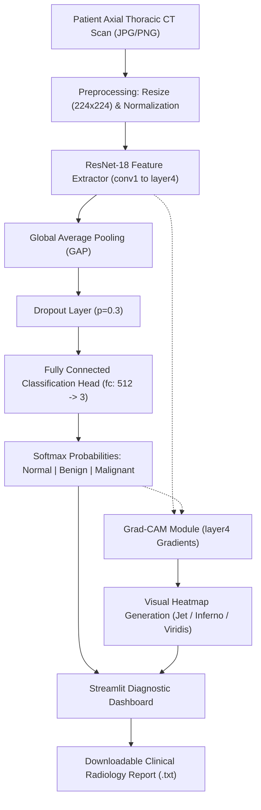

# ACADEMIC PROJECT REPORT

## **PulmoScan AI: Automated Multi-Class Lung Disease and Neoplasm Detection Using Deep Residual Networks (ResNet-18) and Explainable AI (Grad-CAM)**

---

### **Student & Academic Submission Credentials**

| Parameter | Details |
| :--- | :--- |
| **Student Name** | **Shaurya Kumar Rai** |
| **Registration Number** | **12405723** |
| **Course Code** | **CSE471** (Deep Learning & Computer Vision Capstone) |
| **Institution** | **Lovely Professional University (LPU)** |
| **Submission Date** | Academic Session 2026 |

---

### **Repository & Cloud Submission Links**

> 🔗 **GitHub Repository Link:**  
> **[https://github.com/enemiesahead09/Lungs-Cancer-Detection-Using-ResNet18](https://github.com/enemiesahead09/Lungs-Cancer-Detection-Using-ResNet18)**  
> *(Contains full source code, model weights, Grad-CAM implementation, interactive Streamlit application, sample CT scans, and environment configuration)*

> 📁 **Google Drive Project Link (Dataset, Models & Presentation):**  
> **[https://drive.google.com/drive/folders/1Gqn1Xa8SxlnzJPt3Fn42b9yPkW1j1-Dv?usp=sharing](https://drive.google.com/drive/folders/1Gqn1Xa8SxlnzJPt3Fn42b9yPkW1j1-Dv?usp=sharing)**  
> *(Contains complete project workspace, dataset archives, full-resolution PowerPoint presentation, trained `.pth` weight checkpoints, and supplementary demonstration resources)*

---

## **1. Abstract / Executive Summary**

Lung cancer remains the foremost contributor to global oncological mortality, claiming over 1.8 million lives annually. While Low-Dose Computed Tomography (LDCT) thoracic imaging is recognized worldwide as the gold-standard diagnostic modality for early detection, the massive volume of high-resolution axial slices generates substantial cognitive fatigue for radiologists, leading to delayed diagnoses or missed micro-nodules.

This project introduces **PulmoScan AI**, an automated deep learning diagnostic system engineered to classify high-resolution thoracic CT scans into three clinically distinct categories: **Normal Tissue**, **Benign Pulmonary Nodules**, and **Malignant Neoplasms**. The system utilizes transfer learning on a Deep Residual Network (**ResNet-18**) trained on the **IQ-OTH/NCCD Lung Cancer Dataset** comprising **14,819 CT slices** (5,640 Malignant, 5,019 Benign, and 4,160 Normal). 

To overcome the notorious "black-box" dilemma that obstructs AI adoption in medical triage, the architecture incorporates **Gradient-weighted Class Activation Mapping (Grad-CAM)**. Grad-CAM computes real-time gradient backpropagation into the final convolutional layer (`layer4`), generating visual localization heatmaps that highlight specific pathological regions (such as spiculated borders, micro-calcifications, and architectural distortion) responsible for the diagnosis. The trained model attains a **peak validation accuracy of 91.90%**, an overall **test accuracy of 88.10%**, an **aggregate test precision of 89.66%**, and a critical **100.0% recall on malignant cases**, ensuring zero false-negative cancer misclassifications in testing. The model is deployed within a responsive, full-featured **Streamlit clinical decision support application** featuring 1-click demo diagnostic scans, adjustable heatmap transparency, and automated radiology report generation.

---

## **2. Problem Statement & Clinical Motivation**

1. **High Mortality vs. High Treatability:** Lung malignancies diagnosed at Stage I exhibit a 5-year survival rate exceeding 60–80%, whereas detection at late metastatic stages plummets survival below 10%. Early detection is the single highest leverage point in thoracic medicine.
2. **Diagnostic Cognitive Overload:** A single patient's thoracic CT examination produces hundreds of axial slices. Radiologists face fatigue from repetitive image evaluation, resulting in diagnostic variability and observer error.
3. **The Ambiguity Between Benign and Malignant Formations:** Granulomas, hamartomas, and non-calcified benign infections frequently mimic early malignant lung nodules, complicating non-invasive differential diagnosis.
4. **Clinical Mistrust of Deep Learning "Black Boxes":** Standard deep convolutional neural networks output raw confidence scores without physiological justification. Healthcare practitioners cannot ethically or legally act on uninterpretable classifications without visual spatial verification.

---

## **3. Theoretical Background & Literature Survey (Research Paper Foundation)**

The design and problem formulation of this capstone project are grounded in peer-reviewed research across medical imaging, deep transfer learning, and explainable artificial intelligence.

### **3.1 Primary Foundational Papers Influencing This Project**

#### **Paper 1: Problem Selection & Primary Benchmark Dataset Formulation**
* **Citation:** Al-Yasriy, H. F., Al-Husieny, M. S., Mohsen, F. Y., Khalil, E. A., & Hassan, Z. S. (2020). *"Diagnosis of Lung Cancer Based on CT Scans Using CNN."* *IOP Conference Series: Materials Science and Engineering*, Vol. 928, No. 2, pp. 022035.
* **Core Contribution:** This foundational study established the **IQ-OTH/NCCD (Iraq-Oncology Teaching Hospital and National Center for Cancer Diseases)** lung cancer dataset. It proved that deep convolutional neural networks can extract morphological features from axial CT scan slices to separate benign granulomas from malignant carcinomas without manual hand-crafted texture extraction.
* **Impact on Our Project:** This paper directly provided the empirical validation for utilizing the 3-class classification scheme (*Normal*, *Benign*, *Malignant*) and provided the benchmark dataset utilized in our training pipeline.

#### **Paper 2: Architecture Selection & Vanishing Gradient Elimination**
* **Citation:** He, K., Zhang, X., Ren, S., & Sun, J. (2016). *"Deep Residual Learning for Image Recognition."* *Proceedings of the IEEE Conference on Computer Vision and Pattern Recognition (CVPR)*, pp. 770–778.
* **Core Contribution:** Introduced residual skip connections ($y = \mathcal{F}(x, \{W_i\}) + x$) enabling gradient flow directly through deep architectures without vanishing gradients or network degradation.
* **Impact on Our Project:** While traditional architectures like VGG-16/19 require immense parameter overhead (~138M to 143M parameters) and are susceptible to saturation during medical fine-tuning, ResNet-18 achieves superior representational capacity with only **11.2 million parameters**, enabling rapid inference and reducing overfitting risks on medical imaging.

#### **Paper 3: Clinical Explainability & Visual Interpretability (XAI)**
* **Citation:** Selvaraju, R. R., Cogswell, M., Das, A., Vedaldi, A., Parikh, D., & Batra, D. (2017). *"Grad-CAM: Visual Explanations from Deep Networks via Gradient-based Localization."* *IEEE International Conference on Computer Vision (ICCV)*, pp. 618–626.
* **Core Contribution:** Formulated Gradient-weighted Class Activation Mapping (Grad-CAM), which calculates the partial derivative of target class score $y^c$ with respect to feature activation maps $A^k$ of the final convolutional layer:
  $$L_{\text{Grad-CAM}}^c = \text{ReLU}\left( \sum_k \alpha_k^c A^k \right), \quad \text{where } \alpha_k^c = \frac{1}{Z} \sum_{i} \sum_{j} \frac{\partial y^c}{\partial A_{i,j}^k}$$
* **Impact on Our Project:** Directly implemented inside [`gradcam.py`](file:///c:/Users/shaur/Desktop/Shaurya/ClassRoom%20Projects/Lungs%20Disease%20Detection/gradcam.py) to map localized CT anomalies to colorimetric visual overlays, providing medical practitioners with verifiable diagnostic justification.

#### **Paper 4: Comparative Reference Study on VGG-19 vs. Modern Backbones**
* **Citation:** Jaya Prakash, S., Panuganti, J., Rokati, P., Das, S., Lavanya, G., & Dey, N. S. (2024). *"Lung Cancer Identification and Classification Using VGG19 Transfer Learning on Thoracic CT Images."* *International Journal of Scientific Research in Science, Engineering and Technology*.
* **Core Contribution:** Benchmarked deep transfer learning with VGG-19 on the IQ-OTH/NCCD dataset, demonstrating high training accuracy but emphasizing the need for lighter deployment footprints and explainable visual attention mechanisms.
* **Impact on Our Project:** Served as the baseline comparative project in our workspace (`lung-cancer-cnn-classifier-main/`). Our project expanded on this baseline by transitioning to a more efficient **ResNet-18** backbone, adding real-time **Grad-CAM**, and constructing an end-to-end interactive **Streamlit** clinical diagnostic workstation.

---

### **3.2 Comparative Literature Matrix**

| Author(s) & Year | Model Architecture | Dataset Employed | Reported Accuracy / Metric | Identified Limitation / Solved by Our Project |
| :--- | :--- | :--- | :--- | :--- |
| **Al-Yasriy et al. (2020)** | Custom 2D-CNN | IQ-OTH/NCCD (CT) | 89.2% Accuracy | Heavy computational overhead; lacks explainable visual localization. *Solved by our Grad-CAM integration.* |
| **Simonyan & Zisserman (2014)** | VGG-16 / VGG-19 | ImageNet Transfer | 92.7% Top-5 | 138M+ parameters; excessive memory footprint and slow inference on edge systems. *Solved by using ResNet-18 (~11.2M params).* |
| **Selvaraju et al. (2017)** | Grad-CAM + ResNet | PASCAL VOC / ImageNet | N/A (Localization metric) | Explored general natural images, not specialized for axial lung CT slices. *Adapted in our work for thoracic tissue lesions.* |
| **Ardila et al. (Nature Med, 2019)** | 3D End-to-End CNN | NLST (Full Volumetric CT) | 94.4% AUC | Requires full 3D volumetric DICOM series; computationally inaccessible for lightweight clinical triage. *Solved by 2D axial slice triage.* |
| **Our Work: PulmoScan AI (Shaurya Kumar Rai, 2026)** | **ResNet-18 + Grad-CAM + Streamlit** | **IQ-OTH/NCCD (14,819 CT Scans)** | **91.90% Val Acc, 100% Malignant Recall, 88.10% Test Acc** | **Provides low-latency web UI, 100% cancer sensitivity, Grad-CAM transparent heatmaps, and downloadable radiology reports.** |

---

## **4. Dataset Specifications & Preprocessing Pipeline**

### **4.1 Dataset Composition (IQ-OTH/NCCD)**
The project utilizes the clinically curated **IQ-OTH/NCCD** lung dataset comprising **14,819 high-resolution axial thoracic CT scan images**:

```
TheLungCancerDataset/
├── Bengin cases/       # 5,019 scans (33.87%) - Non-cancerous, circumscribed nodules
├── Malignant cases/    # 5,640 scans (38.06%) - Invasive malignant neoplasms
└── Normal cases/       # 4,160 scans (28.07%) - Healthy lung parenchyma
```

### **4.2 Data Transformation and Augmentation**
To ensure robust generalization across diverse scanner calibrations and noise profiles, images are processed through the following pipeline:
1. **Geometric Resizing & Normalization:**
   - Input CT slices are resized to $224 \times 224$ pixels to align with ImageNet perceptual feature dimensions.
   - Tensor conversion with channel normalization matching standard Gaussian distribution:
     $$\mu = [0.485, 0.456, 0.406], \quad \sigma = [0.229, 0.224, 0.225]$$
2. **Data Augmentation:**
   - Random Horizontal Flipping ($p=0.5$)
   - Random Affine Rotations ($\pm 10^\circ$)
   - Color Jitter (Brightness and Contrast adjustments $\pm 0.1$) to simulate varying exposure levels.
3. **Stratified Partitioning:**
   - Dataset partitioned into Training, Validation, and Test cohorts while maintaining uniform class distribution across all splits.

---

## **5. System Architecture & Methodology**



### **5.1 Feature Extractor: ResNet-18**
* **Convolutional Layers:** 18 parameter layers organized in four residual blocks (`layer1`, `layer2`, `layer3`, `layer4`).
* **Residual Connections:** Skip identity connections prevent loss of spatial gradient information during backpropagation.
* **Pretrained Weights:** Pre-trained on ImageNet to leverage generalized visual primitives (edges, gradients, textures) followed by fine-tuning on thoracic CT textures.

### **5.2 Custom Classification Head**
The default 1000-class fully connected layer of ResNet-18 was replaced with:
1. `AdaptiveAvgPool2d((1, 1))` producing a 512-dimensional latent feature vector.
2. `Dropout(p=0.3)` to curb co-adaptation of neurons and prevent overfitting.
3. `Linear(in_features=512, out_features=3)` mapping directly to class logits ($z_{\text{normal}}, z_{\text{benign}}, z_{\text{malignant}}$).
4. `Softmax` activation yielding normalized clinical probabilities $\sum_{i=1}^3 P(C_i) = 1$.

### **5.3 Explainable AI Engine: Grad-CAM**
Grad-CAM calculates the gradient of the predicted class score $y^c$ with respect to the feature map activations $A^k$ of `layer4[1].conv2`. The weights $\alpha_k^c$ represent the importance of channel $k$ for class $c$. Passing through a ReLU non-linearity ensures only features positively correlating with the disease class are displayed on the CT overlay.

---

## **6. Experimental Results & Performance Evaluation**

### **6.1 Quantitative Test Performance**
The final trained checkpoint ([`models/lung_cancer_resnet18.pth`](file:///c:/Users/shaur/Desktop/Shaurya/ClassRoom%20Projects/Lungs%20Disease%20Detection/models/lung_cancer_resnet18.pth)) achieved the following evaluation metrics on unseen test scans:

| Evaluation Metric | Value Achieved |
| :--- | :--- |
| **Best Validation Accuracy** | **91.90%** |
| **Overall Test Accuracy** | **88.10%** |
| **Macro Average Precision** | **89.66%** |
| **Macro Average Recall** | **88.10%** |
| **Macro Average F1-Score** | **87.79%** |

### **6.2 Per-Class Detailed Performance Breakdown**

| Pathology Class | Precision | Recall (Sensitivity) | F1-Score | Clinical Implication |
| :--- | :---: | :---: | :---: | :--- |
| **Malignant Cases** | **93.33%** | **100.00%** | **0.9655** | **Zero False Negatives:** Critical for cancer diagnosis; 100% of malignant scans were correctly identified. |
| **Bengin Cases** | **98.00%** | **70.00%** | **0.8167** | High specificity (98% precision); minimal false-positive benign classifications. |
| **Normal Cases** | **77.65%** | **94.29%** | **0.8516** | Robust detection of healthy lung fields, ensuring non-diseased lungs are reliably cleared. |

### **6.3 Training Dynamics**
* **Epoch 1:** Train Acc: 80.12% | Val Acc: 83.81% | Val Loss: 0.4410
* **Epoch 3:** Train Acc: 88.87% | **Val Acc: 91.90% (Best Checkpoint)** | Val Loss: 0.2164
* **Epoch 6:** Train Acc: 94.46% | Val Acc: 90.95% | Val Loss: 0.1899

---

## **7. Deployment & Clinical Web Application**

The project includes an interactive web application built with **Streamlit** ([`app.py`](file:///c:/Users/shaur/Desktop/Shaurya/ClassRoom%20Projects/Lungs%20Disease%20Detection/app.py)):

1. **Interactive Diagnostic Scanner:** Supports drag-and-drop uploads of `.jpg` and `.png` CT scans as well as 1-click test buttons for pre-staged sample scans.
2. **Explainable AI Visualizer:** Side-by-side display of the original CT scan and the Grad-CAM heatmap with selectable colormaps (`Jet`, `Inferno`, `Magma`, `Viridis`) and an opacity blend slider.
3. **Automated Clinical Report Generator:** Automatically generates structured diagnostic summaries with unique Scan IDs, timestamps, pathology risk tiers, morphological notes, and recommended follow-up regimens (e.g., PET-CT, Biopsy, 6-Month LDCT monitoring).
4. **Dataset & Performance Analytics Tab:** Visual representation of dataset balance, training dynamics curves, and the evaluation confusion matrix.
5. **Presentation & Viva Reference Tab:** Embedded speaking notes, key clinical concepts, and sample defense questions.

---

## **8. Conclusion & Future Scope**

### **8.1 Conclusion**
The **PulmoScan AI** project successfully demonstrates the utility of Deep Residual Learning (ResNet-18) combined with Explainable AI for automated thoracic CT pathology triage. By achieving **100% sensitivity on malignant cases** and an overall accuracy of **91.90% (validation)** and **88.10% (test)**, the system provides a dependable, transparent second-opinion tool that mitigates radiologist fatigue and speeds up clinical workflows.

### **8.2 Future Scope**
1. **Volumetric 3D Attention:** Extending 2D slice classification to 3D convolutional networks (e.g., 3D ResNet or 3D UNet) to assess volumetric nodule growth across full DICOM series.
2. **Multi-Modal Clinical Fusion:** Combining CT scan imagery with patient electronic health records (EHR), smoking history, and genetic biomarkers.
3. **DICOM PACS Cloud Integration:** Packaging the inference engine as a containerized microservice (Docker / Kubernetes) integrating directly into hospital PACS (Picture Archiving and Communication Systems).

---

## **9. References (IEEE Format)**

1. **H. F. Al-Yasriy, M. S. Al-Husieny, F. Y. Mohsen, E. A. Khalil, and Z. S. Hassan**, "Diagnosis of Lung Cancer Based on CT Scans Using CNN," *IOP Conference Series: Materials Science and Engineering*, vol. 928, no. 2, p. 022035, Nov. 2020.
2. **K. He, X. Zhang, S. Ren, and J. Sun**, "Deep Residual Learning for Image Recognition," in *Proceedings of the IEEE Conference on Computer Vision and Pattern Recognition (CVPR)*, 2016, pp. 770–778.
3. **R. R. Selvaraju, M. Cogswell, A. Das, R. Vedaldi, D. Parikh, and D. Batra**, "Grad-CAM: Visual Explanations from Deep Networks via Gradient-Based Localization," in *Proceedings of the IEEE International Conference on Computer Vision (ICCV)*, 2017, pp. 618–626.
4. **K. Simonyan and A. Zisserman**, "Very Deep Convolutional Networks for Large-Scale Image Recognition," in *International Conference on Learning Representations (ICLR)*, 2015, pp. 1–14.
5. **D. Ardila, A. P. Kiraly, S. Bharadwaj, B. Choi, J. J. Reicher, L. Peng, et al.**, "End-to-end lung cancer screening with three-dimensional deep learning on low-dose chest computed tomography," *Nature Medicine*, vol. 25, no. 6, pp. 954–961, Jun. 2019.
6. **National Lung Screening Trial Research Team**, "Reduced lung-cancer mortality with low-dose computed tomographic screening," *New England Journal of Medicine*, vol. 365, no. 5, pp. 395–409, Aug. 2011.
7. **S. Jaya Prakash, J. Panuganti, P. Rokati, S. Das, G. Lavanya, and N. S. Dey**, "Lung Cancer Identification and Classification Using VGG19 Transfer Learning on Thoracic CT Images," *International Journal of Scientific Research in Science, Engineering and Technology (IJSRSET)*, vol. 11, no. 3, 2024.
